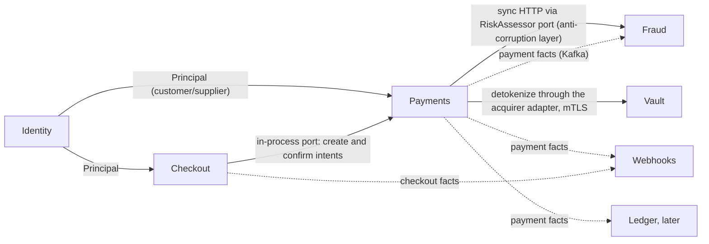

# Architecture

This document is the living reference for how Iris Gate is structured and which conventions every change follows. It describes the system as it stands and marks planned parts with the phase that delivers them.

- The detailed target design (flows, data model, API surface) is in [`design/to-be.md`](design/to-be.md).
- The current state, with its defects, is in [`design/as-is.md`](design/as-is.md).
- Structural decisions are recorded in [`adr/`](adr/).

## 1. Principles

- **Strategic DDD with one hexagon per bounded context** ([ADR-0001](adr/0001-ddd-hexagonal-by-context.md)).
- **Contracts are the source of truth**: OpenAPI and AsyncAPI specs generate the Go and TypeScript types ([ADR-0003](adr/0003-contracts-as-source-of-truth.md)).
- **Transactional messaging**: state changes and their events commit together through an outbox; consumers dedupe with an inbox ([ADR-0002](adr/0002-outbox-inbox-for-kafka-atomicity.md)).
- **Decisions are synchronous, facts are asynchronous**: anything a caller waits on (risk score, acquirer call) is a direct call with a timeout; Kafka carries what already happened.
- **Fail closed**: when the system cannot decide safely, it holds or rejects, never approves.
- **Tenant isolation in depth**: the merchant comes from the authenticated principal, and the database enforces it again.

## 2. Deployable units

| Unit | Stack | Owns | Status |
| --- | --- | --- | --- |
| `apps/api` | Go 1.27, chi, pgx v5, slog | identity, payments; later checkout, webhooks; HTTP API and background worker | exists |
| `apps/anti-fraud` | NestJS 12, KafkaJS, Prisma 7 | fraud scoring, features and labels | exists (async today; sync endpoint in phase 10) |
| `apps/web` | Next.js 16.4, React 19.3, Tailwind 4, shadcn/ui, next-intl | merchant dashboard, platform console, hosted checkout; backend for frontend | exists (dashboard only) |
| `apps/vault` | Go | card tokenization and detokenization | phase 14 |
| Postgres 18 | | databases `iris`, `antifraud`, later `vault` | exists |
| Kafka (KRaft) + Karapace | | event backbone and schema registry | exists |
| OpenBao | | key manager (Transit) for the vault and webhook secrets | phase 14 |
| Mailpit | | local SMTP for user emails | phase 8 |

The component diagram of the target system is in [`design/to-be.md`](design/to-be.md) section 3.

## 3. Bounded contexts

| Context | Code | Ubiquitous language | Responsibility | Status |
| --- | --- | --- | --- | --- |
| Identity | `libs/identity` (Go) | Merchant, User, Membership, Role, Permission, APIKey, Principal | merchants, users, sessions, roles, API keys, platform staff, audit log | merchants and API keys exist; users and RBAC in phase 8 |
| Payments | `libs/payments` (Go) | PaymentIntent, Money, Attempt, Review, Refund, PaymentSettings | payment lifecycle, risk call, acquirer calls, capture policy, reviews, refunds | exists; new lifecycle in phase 11 |
| Checkout | `libs/checkout` (Go) | Product, Price, CheckoutSession, PaymentLink, CheckoutSettings | catalog, hosted checkout sessions, payment links, branding | phase 15 |
| Webhooks | `libs/webhooks` (Go) | WebhookEndpoint, Delivery | signed event delivery to merchants, request log | phase 16 |
| Fraud | `libs/fraud` (TypeScript), run by `apps/anti-fraud` | RiskAssessment, Specification, Score, Decision, FeatureSnapshot | risk scoring, features, labels | exists |
| Vault | `libs/vault` (Go), run by `apps/vault` | CardToken, Fingerprint, DataKey | test-card tokenization, envelope encryption | phase 14 |
| Ledger | `libs/ledger` | Account, JournalEntry | double-entry postings from payment events | later |

`libs/shared` holds the shared kernel: the `Actor` value object (phase 8) and the tenant transaction helper (phase 7).

### Context map



- **Identity → everyone:** contexts depend on the `Principal` contract (merchant id, actor, permissions), never on identity tables.
- **Checkout → Payments:** checkout drives payments through an application port implemented by an adapter over the payments use cases.
- **Payments → Fraud:** a synchronous scoring call through a port that translates payments concepts into the fraud contract; fraud's internals never leak into payments. Facts flow back to fraud over Kafka for features and labels.
- **Payments → Vault:** only the acquirer adapter calls the vault, to detokenize just before the acquirer call.
- **Webhooks, Ledger:** eventually consistent consumers of published facts.

## 4. Repository layout

```text
iris-gate/
├── apps/
│   ├── api/            Go composition root: cmd/api (HTTP), cmd/worker (phase 12), cmd/irisctl (phase 6)
│   ├── anti-fraud/     NestJS composition root for libs/fraud
│   ├── web/            Next.js dashboard, console, hosted checkout
│   └── vault/          Go composition root for libs/vault (phase 14)
├── libs/
│   ├── contracts/      http/*.openapi.yaml, events/asyncapi.yaml + JSON Schemas, generated/{go,ts}
│   ├── identity/       domain, application, infra (Go)
│   ├── payments/       domain, application, infra (Go)
│   ├── checkout/       phase 15
│   ├── webhooks/       phase 16
│   ├── vault/          phase 14
│   ├── fraud/          domain, application (TypeScript package @iris-gate/fraud)
│   ├── sdk-web/        typed server-side client used by apps/web
│   └── shared/         shared kernel (Go)
├── configs/            tool configs shared by several packages (TypeScript, ESLint, golangci-lint)
├── infra/              docker/ (Compose stack, Postgres initdb, Kafka topics); later pki/ and terraform/
├── tools/              developer scripts, each behind a root make target
└── docs/               design/ (as-is, to-be, design system), specs/, plans/, roadmap, architecture, security, adr/
```

## 5. Inside a context

Each context is a hexagon with three layers:

```text
libs/<context>/
├── domain/        entities, value objects, domain events, errors. No framework, database or network imports.
├── application/   use cases and ports (repositories, acquirer, risk assessor, clock, id generator).
└── infra/         adapters: pgstore (Postgres), httpapi (chi handlers), acquirer, kafkarelay, idempotency, ...
```

Dependency rule: `infra → application → domain`. `domain` imports nothing from chi, pgx, Kafka, Nest, Prisma or another context. Generated DTOs are mapped to domain types in `infra`. `apps/*` only compose: config, pools, adapters and `Mount`.

## 6. Communication rules

| Kind | Mechanism | Used for |
| --- | --- | --- |
| In process, across contexts | application port + adapter | checkout → payments |
| Synchronous, across services | internal HTTP with a timeout and a fail-closed fallback | payments → anti-fraud (300 ms budget), acquirer adapter → vault (mTLS) |
| Asynchronous | Kafka, outbox on the producer, inbox on the consumer | facts for features, labels, audit, webhooks, ledger |
| Shared data | none | contexts never read or write another context's tables |

## 7. Cross-cutting patterns

| Pattern | Rule | Where it is specified |
| --- | --- | --- |
| Outbox | the state change and its outbox row commit in one transaction; a relay publishes and marks `published_at` | ADR-0002 |
| Inbox | a consumer inserts the event id before any side effect; a duplicate is skipped | ADR-0002 |
| Idempotency keys | mutating merchant routes that create resources require `Idempotency-Key`; records are keyed by merchant, scope and key; same body replays, different body is 409 | to-be section 12, phase 6 |
| Optimistic locking | aggregates carry `version`; updates are conditional; a lost race is 409 | phases 6 and 11 |
| Tenant scoping | merchant id from the principal; repositories require it; Postgres RLS on merchant tables; other merchants' resources are 404 | to-be section 9, phase 7 |
| Actor attribution | every mutation records `actor_type`, `actor_id`, `request_id` | to-be section 4.5, phase 8 |
| Fail closed | risk unavailable means `REVIEW`; key manager unavailable means 503 | to-be decisions 8 and 22 |
| Retry and DLQ | transient consumer errors go to retry topics with backoff, then to a DLQ; poison messages go straight to the DLQ | to-be section 7.2, phase 13 |

## 8. Conventions

### HTTP

- Routes under `/v1`. JSON fields in `snake_case`. Errors as RFC 7807 `application/problem+json`.
- Authentication with `Authorization: Bearer` (API key or user JWT).
- A breaking change goes to `/v2`, except the one-time in-place change of the payments v1 contract recorded in phase 11.

### Events

- Topic: `<context>.<aggregate>.<event>.v<n>`, for example `payments.payment_intent.captured.v1`.
- Message key: the aggregate id, so events of one aggregate stay ordered.
- Headers: `event-id`, `event-type`, `occurred-at`, `request-id`, `traceparent` when present.
- Payload includes `merchant_id`, `actor_type`, `actor_id`.
- JSON Schema in the registry with `BACKWARD` compatibility; a breaking change is a new `.vN` topic.
- Retry and dead-letter topics: `<topic>.retry.<n>`, `<topic>.dlq`.

### Code

- Code, identifiers, comments, docs and commit messages in English. Commits follow Conventional Commits (enforced by lefthook).
- Money is `int64` minor units plus an ISO-4217 currency. No floats.

## 9. Toolchain

| Concern | Choice |
| --- | --- |
| Go | 1.27 (toolchain go1.27.4), workspace via `go.work` |
| Node | 26 LTS runtime (`engines` `>=24.11.0`), Yarn 4.18 workspaces through Corepack (`nodeLinker: node-modules`), TypeScript 6.0 |
| Task runner | Make (root delegates to each app and infra) |
| HTTP router (Go) | chi v5 |
| SQL (Go) | pgx v5 with hand-written queries; migrations embedded with `go:embed` and applied in order |
| ORM (TypeScript) | Prisma 7 with the `@prisma/adapter-pg` driver adapter; client generated into `src/infra/prisma/generated/` |
| Kafka clients | segmentio/kafka-go (Go), KafkaJS 2.2 (Node) |
| Contracts codegen | oapi-codegen (Go), openapi-typescript (TS) |
| Web | Next.js 16.4, React 19.3, TanStack Query 5 and Table 9, Tailwind 4 (OKLCH tokens), shadcn/ui, next-intl (`en`, `pt`, `es`), iron-session |
| Lint and format | golangci-lint v2.15 and ESLint 10 flat config, both from `configs/`, with architecture rules (depguard, `no-restricted-imports`); gofumpt and Prettier |
| Shared configs | `configs/`: TypeScript bases, ESLint for Node packages, golangci-lint |
| Git hooks | lefthook: format, vet, gitleaks, Conventional Commits |
| Tests | Go `testing` with `-race`, Jest 30 (Nest, run with `--experimental-vm-modules` because NestJS 12 ships ES modules), Vitest 5 (web), Playwright (end to end) |
| CI | GitHub Actions with per-app path filters |
| Local infra | Docker Compose: Postgres 18.6, Kafka 4.4 (KRaft), Karapace 6.2; later OpenBao and Mailpit |

## 10. Not planned

Multi-region or active-active recovery, a saga orchestrator (outbox and inbox cover the flows), real acquirer integrations, payment methods other than cards, and a plugin system. Later ideas are listed in [`roadmap.md`](roadmap.md).
