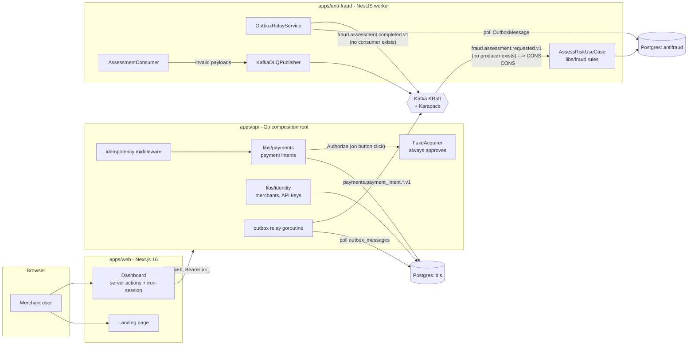
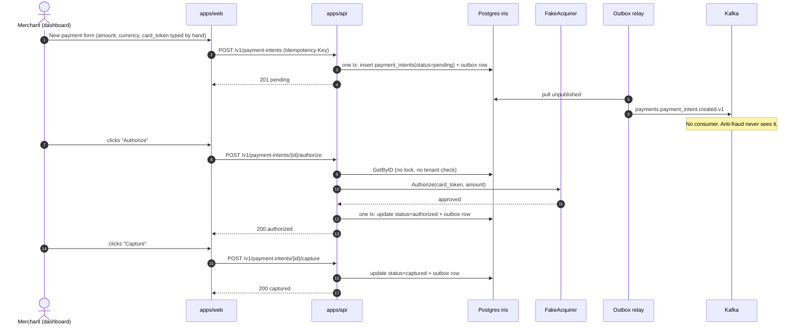
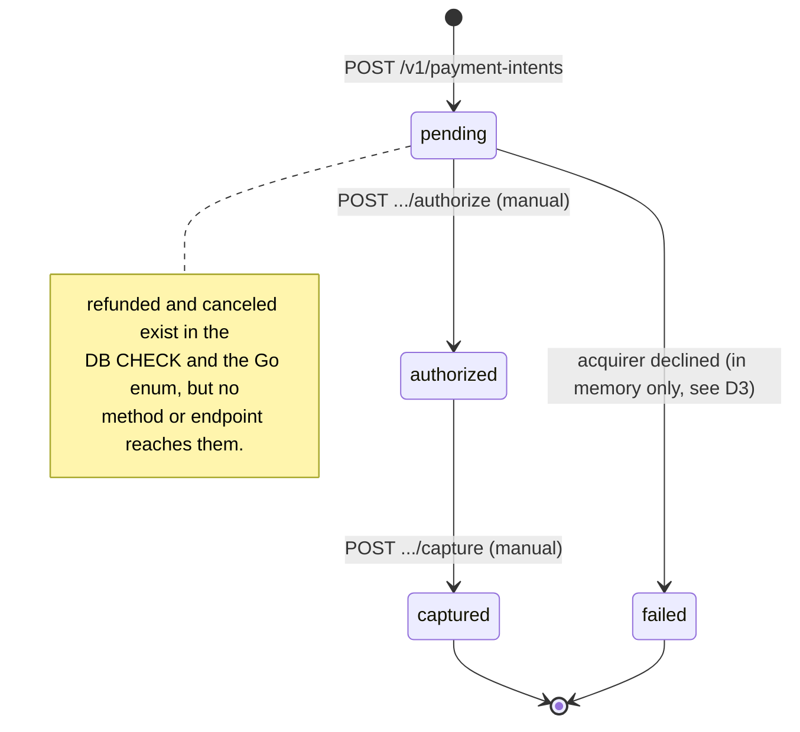
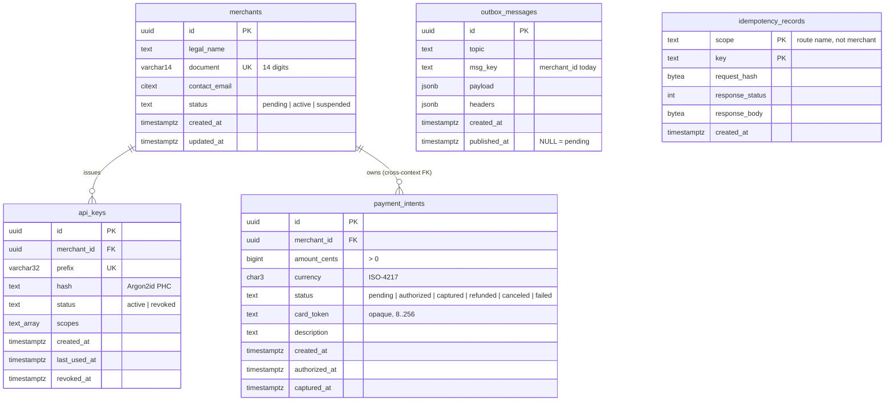
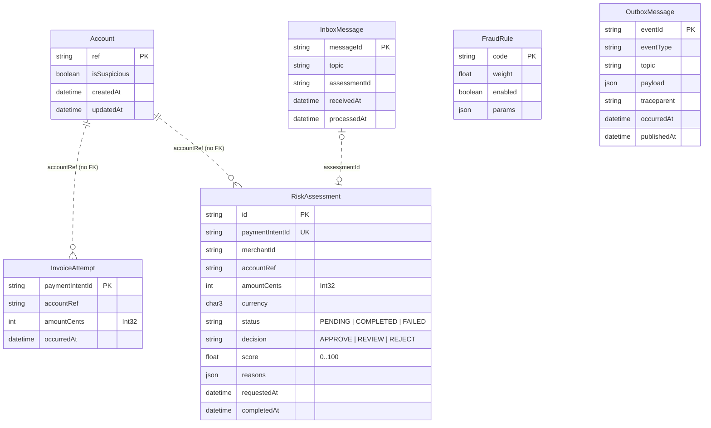
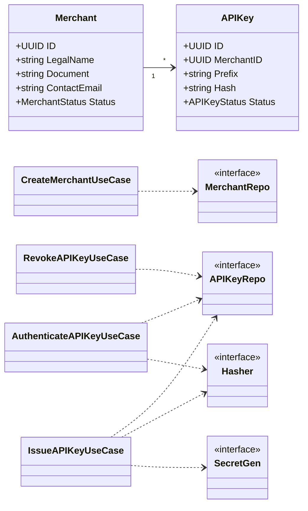
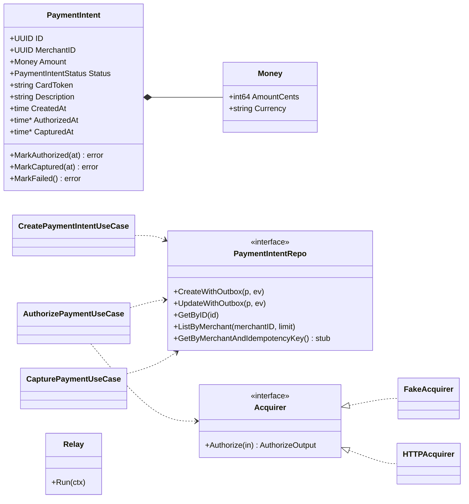
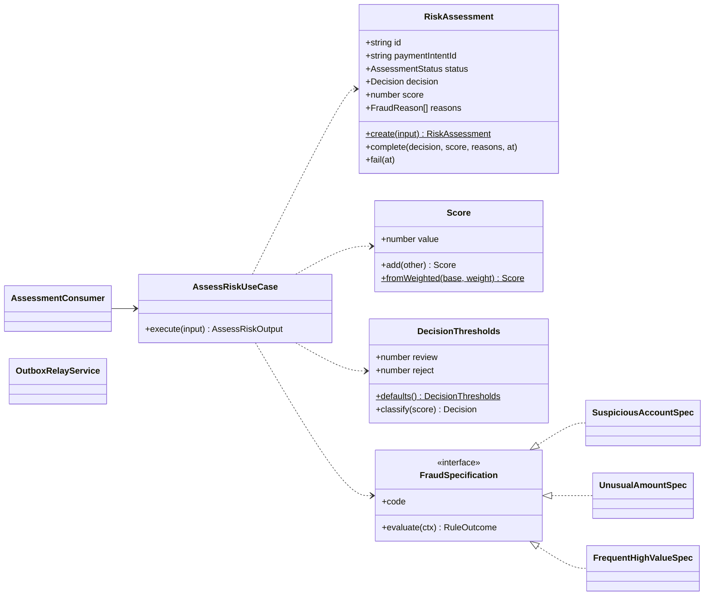

# Iris Gate: as-is (current state)

> Snapshot of what the code does on 2026-11-10 (commit `7195707`). Every claim here was read from the source, not from older docs. Where `docs/architecture.md` or `docs/roadmap.md` disagree, this file and the code win.
>
> The target design is in [`to-be.md`](to-be.md).

## 1. Summary

- Three processes: `apps/api` (Go), `apps/anti-fraud` (NestJS worker) and `apps/web` (Next.js dashboard and landing page).
- Two Postgres databases: `iris` (identity and payments share it) and `antifraud`.
- Kafka carries events through a transactional outbox on both sides. The anti-fraud consumer deduplicates with an inbox.
- **The payment flow and the fraud engine are not connected.** Payments publishes `payments.payment_intent.created.v1`; anti-fraud only consumes `fraud.assessment.requested.v1`, which nothing produces.
- **Authorization and capture are manual.** A new intent stays `pending` until someone clicks **Authorize** and then **Capture** on the dashboard detail page. No risk check runs before the acquirer call.

## 2. Components and data flow

Dashed edge: wired on the consumer side only. Nothing in the repo writes that topic, and nothing reads `fraud.assessment.completed.v1`.

## 3. Payment sequence today

## 4. Payment intent state machine

## 5. Data model

### 5.1 Database `iris` (identity + payments)

Not stored: the acquirer reference (`acquirer_ref` exists only in the authorized event), failure reason, capture method, risk decision, and any row version.

### 5.2 Database `antifraud`

## 6. Classes

### 6.1 Identity (Go, `libs/identity`)

### 6.2 Payments (Go, `libs/payments`)

The `Acquirer` port has no `Capture`, `Void` or `Refund`: capture is a local status change only.

### 6.3 Fraud (TypeScript, `libs/fraud` + `apps/anti-fraud`)

## 7. Kafka topics today

| Topic | Producer | Consumer | Key |
| --- | --- | --- | --- |
| `identity.merchant.created.v1` | none (schema only) | none | n/a |
| `payments.payment_intent.created.v1` | payments outbox relay | none | merchant_id |
| `payments.payment_intent.authorized.v1` | payments outbox relay | none | merchant_id |
| `payments.payment_intent.captured.v1` | payments outbox relay | none | merchant_id |
| `fraud.assessment.requested.v1` | **none** | anti-fraud | payment_intent_id |
| `fraud.assessment.completed.v1` | anti-fraud outbox relay | none | payment_intent_id |
| `fraud.assessment.failed.dlq` | anti-fraud consumer | none | n/a |

## 8. Gaps and defects

### 8.1 Defects (bugs in code that exists)

| ID | Severity | Defect | Where |
| --- | --- | --- | --- |
| D1 | Critical | **Cross-tenant authorize and capture.** `handleAuthorize` and `handleCapture` load the intent by id without checking `pi.MerchantID` against the authenticated merchant. Any valid API key can authorize or capture another merchant's intent. `GET /v1/payment-intents/{id}` does check. | `libs/payments/infra/httpapi/handlers.go` |
| D2 | Critical | **Idempotency keys are global, not per merchant.** The scope is the constant `create_payment_intent`. Two merchants that send the same key and body get the first merchant's stored response, including its `card_token`; a different body returns 409. | `apps/api/cmd/api/main.go:100`, `idempotency_records` PK |
| D3 | High | **Acquirer decline is not persisted.** `AuthorizePaymentUseCase` calls `MarkFailed()` in memory and returns; the row stays `pending` and no event is written. | `libs/payments/application/authorize_payment.go` |
| D4 | High | **Double authorization under concurrency.** Authorize reads, calls the acquirer, then updates with no row lock, version check or conditional `WHERE status = ...`. Two concurrent calls both hit the acquirer. | `authorize_payment.go`, `pgstore.UpdateWithOutbox` |
| D5 | Medium | `acquirer_ref` is never stored, so a later capture, void or refund cannot reference the authorization. | `payment_intents` schema |
| D6 | Medium | Anti-fraud stores amounts as Prisma `Int` (32-bit). Amounts above 21,474,836.47 overflow, while payments uses `int64`. | `apps/anti-fraud/prisma/schema.prisma` |
| D7 | Low | `GetByMerchantAndIdempotencyKey` is a stub that always returns not found. | `libs/payments/infra/pgstore/pgstore.go` |
| D8 | Critical | **Identity bootstrap endpoints are public.** `POST /v1/merchants`, `POST /v1/api-keys` and `POST /v1/api-keys/{id}/revoke` have no authentication ("hardening in phase 7"). Anyone who knows a merchant id can issue a working API key for that merchant, which is a full account takeover, and anyone can revoke any key. | `libs/identity/infra/httpapi/handlers.go` (`Mount`) |
| D9 | Medium | **The dashboard logs in with the merchant's secret API key** and keeps it in the session cookie. There are no user accounts, so every dashboard action is attributed to "the merchant", and a leaked session is a leaked integration key. | `apps/web/src/lib/session.ts`, `apps/web/src/app/[locale]/login/actions.ts` |

### 8.2 Missing behavior (gaps against a market-standard gateway)

| ID | Gap |
| --- | --- |
| G1 | No risk check before authorization. Payments and fraud are not connected at all. |
| G2 | Authorization is triggered by a dashboard button, not by a customer checkout. Capture is always manual; there is no automatic capture and no per-merchant capture setting. |
| G3 | No checkout or tokenization. The card token is typed by hand into the dashboard form. |
| G4 | No cancel (void), refund, authorization expiry, or review queue. |
| G5 | The acquirer port only authorizes. The fake acquirer always approves, so declines cannot be demonstrated. |
| G6 | Fraud history (`InvoiceAttempt`) is only written by the assessment request itself; real payment outcomes (authorized, declined, captured, refunded) never reach the fraud engine. |
| G7 | Payments has no inbox, so it cannot safely consume events. |
| G8 | `payment_intents.merchant_id` is a foreign key into identity's table, against the rule that contexts do not share tables. |
| G9 | Playwright covers only unauthenticated pages. There is no end-to-end test of a payment. |
| G10 | Visual identity: the green palette is used for backgrounds, borders and muted text, so large surfaces read as tinted green. |
