# Iris Gate: to-be (target design)

> Status: **approved by the project owner (2026-11-10)**. It describes where Iris Gate is going and why. The current state is in [`as-is.md`](as-is.md). The delivery phases that take us from one to the other are specified in [`../specs/`](../specs/README.md).
>
> `AGENTS.md` describes the code **as it is today**. When a phase changes a behavior that `AGENTS.md` documents, that phase updates `AGENTS.md` in the same change.

## 1. Purpose and disclaimer

Iris Gate is a **portfolio project**. It will never run in production, process real money, or be sold. A real gateway also needs card-scheme certification, PCI DSS assessment, a payment-institution license and legal work that is out of scope here.

The goal is to show, in code a reviewer can run locally, how a market-standard card gateway is built: the payment lifecycle that Stripe, Adyen and Mercado Pago expose, the integration modes they offer (hosted checkout, payment links, direct API), real-time fraud scoring, idempotency, transactional messaging, user and permission management, strict tenant isolation, and envelope encryption of card data.

## 2. Decisions

All decisions below are **agreed** by the project owner.

### 2.1 Payment flow

| # | Decision |
| --- | --- |
| 1 | Follow the market payment flow: the customer pays at checkout, risk is scored, the acquirer authorizes, and the payment is captured. No human step in the normal path. |
| 2 | **Automatic capture is the default.** Manual capture happens only when the merchant configures it. |
| 3 | **Fraud scoring is synchronous**, inside payment confirmation and before the acquirer call. Kafka is not in the decision path. |
| 4 | Human review exists only for `REVIEW` decisions (the gray zone), never for every payment. |
| 5 | Capture method is a merchant setting (`automatic` or `manual`) owned by the payments context, with an optional per-intent override. |
| 6 | A `REVIEW` decision authorizes the payment (funds held) and holds it in `requires_review`. Approving captures it, or moves it to `requires_capture` under manual capture. Rejecting voids the authorization. |
| 7 | Card data never touches apps/api or apps/web servers. A simulated card vault tokenizes **test card numbers only**. |
| 8 | If the risk call times out or errors, the decision is `REVIEW` (fail closed). |
| 9 | Fake acquirer outcomes are driven by test cards (approve, decline, insufficient funds, timeout), so every path can be demonstrated. |
| 10 | **Review mode is a merchant setting**: `merchant` (the merchant's users with `reviews.resolve` decide in the dashboard, Stripe model) or `platform` (Iris Gate risk staff decide in the platform console, Mercado Pago model). Default `merchant`. |
| 11 | A review has a **deadline** (`review_timeout_hours`, default 72, always shorter than the authorization TTL). When it expires, the authorization is voided. A review is never approved because time ran out. |

### 2.2 Identity and access

| # | Decision |
| --- | --- |
| 12 | Two kinds of principal. **People** sign in to the dashboard and the console with email and password. **Systems** call the API with API keys. The dashboard never uses an API key. |
| 13 | Three **API key kinds**: `secret` (server side, full merchant API), `publishable` (browser side, only tokenization and checkout), `restricted` (secret with a subset of permissions). Secret and restricted keys are shown once and stored as Argon2id hashes; publishable keys are public. Keys have a name, can be rolled with an overlap window (default 24 h, max 7 days), revoked, and show when they were last used. |
| 14 | **Authentication lives in the Go identity context.** Passwords are Argon2id. Access tokens are JWTs signed with Ed25519 (`EdDSA`), valid 15 minutes. Refresh tokens are opaque, stored as hashes, rotated on every use, and a reused refresh token revokes its whole family. Next.js is a **backend for frontend**: it keeps the tokens in the encrypted, `httpOnly` iron-session cookie, and browser JavaScript never sees them. |
| 15 | **Role-based access control.** Fixed roles map to permissions in code. Handlers check a permission, never a role name. Enforcement is in Go; the UI only hides what the user cannot do. |
| 16 | **Memberships.** A user can belong to several merchants with one role in each. The access token carries the active merchant; switching merchant issues a new token. |
| 17 | **Platform staff** are users with a platform role (`platform_admin` now, `platform_support` later). Their tokens have a separate audience (`iris-platform`) and only work on `/v1/platform/*`. The console lives at `/admin` in apps/web. Impersonation ("view as merchant") comes later, read-only and audited. |
| 18 | **Actor attribution.** Every payment state change and every administrative action records `actor_type` (`user`, `api_key`, `platform_user`, `system`), `actor_id` and `request_id`. Automatic actions use `actor_type = system` with the job name as `actor_id`. The actor is never null and there is no fake "system user". |
| 19 | **Merchant onboarding** supports both paths. Sales-led: a platform admin creates the merchant in the console and invites the owner by email. Self-signup: anyone creates an account; the merchant starts `pending` and becomes `active` only after a platform admin approves it (simulated KYC). The first platform admin is created by a CLI command, never by a public endpoint. |

### 2.3 Data protection

| # | Decision |
| --- | --- |
| 20 | **Tenant isolation in layers.** The merchant id always comes from the authenticated principal, never from the body or the URL. Repository methods require the merchant id. Postgres row-level security protects merchant-scoped tables. A resource of another merchant answers 404, not 403. A cross-tenant test suite runs in CI. |
| 21 | **Least-privilege database roles.** Each database has a migrator role (owns the schema, runs DDL) and an app role (DML only, no `BYPASSRLS`). Jobs that scan across merchants use a separate worker role. No service connects as a superuser, and no service can connect to another service's database. |
| 22 | **Envelope encryption in the vault.** Each card number is encrypted with AES-256-GCM under its own data key; the data key is wrapped by a master key that never leaves the key manager. Ciphertext is bound to its token and merchant through additional authenticated data. Fingerprints are keyed HMACs computed by the key manager. CVV is validated and discarded, never stored. Only the acquirer adapter can detokenize, over mTLS, and every detokenization is audited. Locally the key manager is **OpenBao Transit** behind a `KeyManager` port, so an AWS KMS adapter can replace it later. |

### 2.4 Integration modes

| # | Decision |
| --- | --- |
| 23 | Iris Gate offers the three market integration modes: **hosted checkout sessions**, **payment links**, and the **direct API**. Embedded card fields on the merchant's own page come later. |
| 24 | A checkout session is **created server to server** with a secret key. The redirect URL carries only the opaque session id; amounts and items come from the catalog or from the session, never from URL parameters. Reaching the success URL is not proof of payment: merchants confirm with a webhook or a `GET`. |
| 25 | **Catalog**: products and prices are separate. A price is immutable (to change an amount, create a new price and archive the old one). |
| 26 | **Webhooks** are signed (HMAC-SHA256 over timestamp and body), retried with backoff, and listed per delivery in the dashboard. The dashboard also shows the merchant's **API request log**. |

## 3. Components

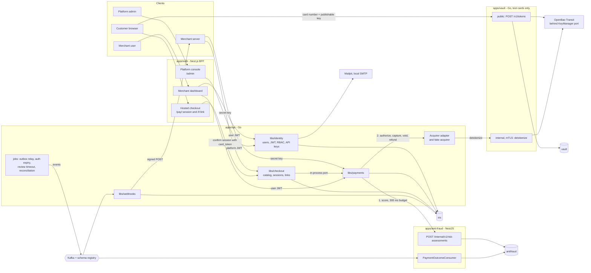

Bounded contexts after the change: `identity`, `payments`, `checkout` (catalog, sessions, links, branding), `webhooks` and `fraud`, plus the vault as its own app. Contexts call each other only through ports (in process) or versioned events; they never share tables. The shared `Actor` value object lives in `libs/shared`.

## 4. Identity and access

### 4.1 Principals

| Principal | Authenticates with | Used by | Token audience |
| --- | --- | --- | --- |
| Merchant user | email + password, then access JWT | merchant dashboard (through the BFF) | `iris-dashboard` |
| Platform user | email + password, then access JWT (MFA later) | platform console (through the BFF) | `iris-platform` |
| Secret or restricted API key | `Authorization: Bearer irk_<prefix>.<secret>` | merchant servers | n/a |
| Publishable API key | `ipk_<id>` in the request | customer browsers: vault tokenization, hosted checkout | n/a |

A single middleware in apps/api turns any of these into a `Principal { type, id, merchant_id, permissions }` and puts it in the request context. Handlers ask `principal.Can(permission)`. The repository layer reads `merchant_id` from the principal, never from input.

### 4.2 Sign-in and token refresh

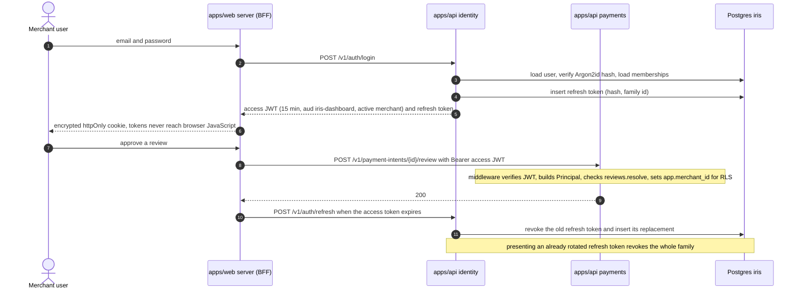

Rules:

- JWT claims: `sub` (user id), `aud`, `mid` (active merchant id), `role`, `sid` (refresh family id), `jti`, `iat`, `exp`. Permissions are resolved from the role in code at request time, so a role change applies within one access-token lifetime.
- Signing keys have a `kid`. The public keys are served at `GET /.well-known/jwks.json`. Rotation keeps the previous key valid until its tokens expire.
- Login answers the same generic error for unknown email and wrong password, runs in constant time, and is rate limited per email and per IP.
- Passwords: 12 to 128 characters, Argon2id with at least the OWASP minimum parameters.
- Email verification, invitation and password-reset links are single-use tokens stored as hashes, with an expiry (invitation 72 h, reset 1 h). Locally, mail goes to Mailpit.
- Logout revokes the refresh family. Changing the password revokes every family of the user.
- Re-authentication (password again, valid 5 minutes) is required to create or roll an API key and to change member roles.

### 4.3 Roles and permissions

| Permission | owner | admin | developer | operations | risk_analyst | viewer |
| --- | :-: | :-: | :-: | :-: | :-: | :-: |
| `payments.read` | x | x | x | x | x | x |
| `payments.write` (create intents) | x | x | x | x | | |
| `payments.capture` | x | x | | x | | |
| `payments.cancel` | x | x | | x | | |
| `refunds.create` | x | x | | x | | |
| `reviews.resolve` | x | x | | | x | |
| `catalog.write` | x | x | x | x | | |
| `checkout.write` (sessions, links) | x | x | x | x | | |
| `settings.write` (payment, checkout, review) | x | x | | | | |
| `api_keys.manage` | x | x | x | | | |
| `webhooks.manage` | x | x | x | | | |
| `logs.read` (request log, audit log) | x | x | x | | | |
| `members.manage` | x | x | | | | |
| `merchant.profile.write` | x | | | | | |

- Exactly one `owner` per merchant. Only the owner can transfer ownership.
- A secret API key has every permission except `members.manage`, `settings.write` and `merchant.profile.write` (people-only actions). A restricted key has the subset chosen at creation. A publishable key has only `tokens.create` and `checkout.confirm`.
- When `review_mode = platform`, `reviews.resolve` is granted to platform staff instead; merchant users see the review but cannot decide it.
- Platform roles: `platform_admin` (merchants: create, approve, suspend; staff; review queue for `platform` mode; read-only metrics). `platform_support` is defined later.

### 4.4 Merchant onboarding

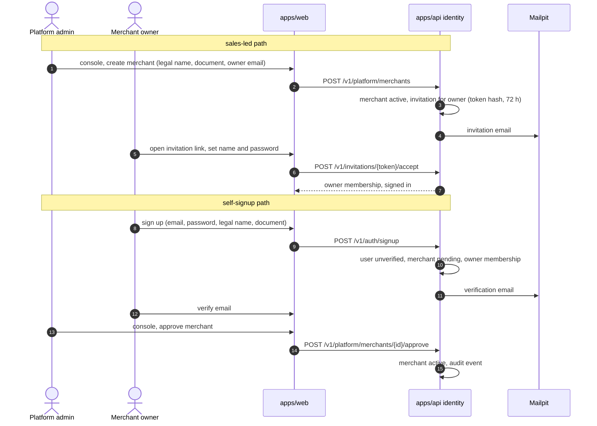

- `pending` merchants can sign in, invite members, configure settings and create keys, but payment and checkout endpoints answer 403 `merchant_not_active` until approval.
- `suspended` merchants: API keys get 403, the dashboard is read-only.
- The first platform admin: `make bootstrap-admin EMAIL=...` runs `irisctl bootstrap-admin`, which creates the user and prints a one-time password-setup link.

### 4.5 Actor attribution

| Origin | `actor_type` | `actor_id` |
| --- | --- | --- |
| Dashboard click | `user` | user id |
| Merchant integration | `api_key` | API key id (tells which merchant system called) |
| Console action | `platform_user` | user id |
| Automatic action | `system` | job or component name, for example `auth-expiry`, `review-timeout`, `risk-engine` |

- Payment history goes to `payment_intent_events`, append-only, written in the same transaction as the state change (and the outbox row).
- Administrative actions (keys, members, settings, merchant status, staff) go to `audit_events`, append-only, same transaction as the change, chained with `prev_hash` to make tampering visible.
- Actor ids have **no foreign key** to `users`: contexts do not share tables, and history must outlive the user. Users are disabled, never deleted.

## 5. Integration modes and checkout

### 5.1 Modes

| Mode | Stripe | Mercado Pago | Adyen | Iris Gate |
| --- | --- | --- | --- | --- |
| Hosted payment page (redirect) | Checkout | Checkout Pro | Hosted Payment Pages | Checkout Session, `/pay/{session_id}` |
| Payment link | Payment Links | Link de pagamento | Pay by Link | Payment Link, `/l/{link_id}` |
| Card fields embedded in the merchant page | Elements | Bricks | Components / Drop-in | later |
| Direct API, server to server | PaymentIntents API | Checkout Transparente | Checkout API | Payment Intents API (exists) |

### 5.2 Hosted checkout session

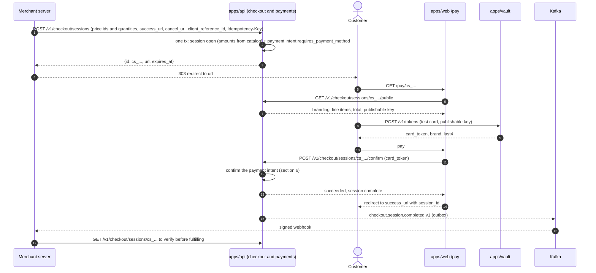

Rules:

- Session ids and link ids carry at least 128 bits of randomness; they are capabilities.
- `success_url` and `cancel_url` must be absolute `https` URLs (`http` only for `localhost`). If the merchant configured `allowed_redirect_domains`, the host must match one of them. This prevents open redirects.
- A session expires after 24 h (configurable down to 30 min). Expiring a session cancels its payment intent.
- Line items are snapshotted into the session (price id, description, unit amount, quantity), so later catalog changes do not alter an open session.
- The public session endpoint returns display data only: branding, items, total, currency, publishable key, status. It never returns the merchant's ids beyond what the page needs.
- A payment link points to one active price and a quantity. Opening `/l/{link_id}` creates a fresh checkout session and redirects to it.
- Branding (display name, logo URL, brand color, support email) is a merchant setting of the checkout context.

## 6. Payment lifecycle

### 6.1 State machine

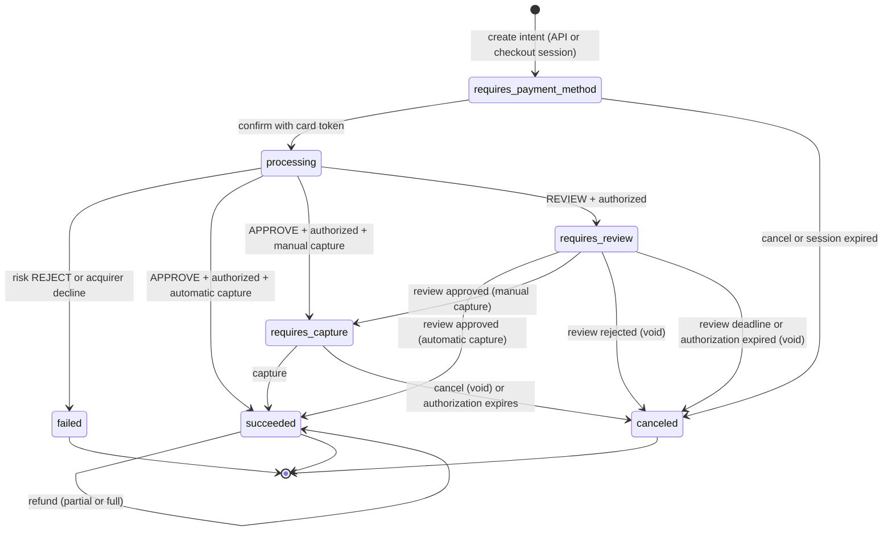

- `processing` is persisted **before** the acquirer call. An intent stuck in `processing` after a crash is resolved by the reconciliation job, which asks the acquirer for the attempt result using the attempt id as the acquirer idempotency key.
- A refund does not change the status. The intent keeps `succeeded` and tracks `amount_refunded`; each refund is its own record.
- An authorization hold expires after 7 days (configurable). The expiry job voids it and moves the intent to `canceled` with `cancellation_reason = authorization_expired`.
- `failed` carries a `failure_code`: `fraud_rejected`, `card_declined`, `insufficient_funds`, `acquirer_unavailable`.
- `canceled` carries a `cancellation_reason`: `requested`, `review_rejected`, `review_expired`, `authorization_expired`, `session_expired`.
- Every transition writes one `payment_intent_events` row with the actor (section 4.5).

### 6.2 Confirm with automatic capture

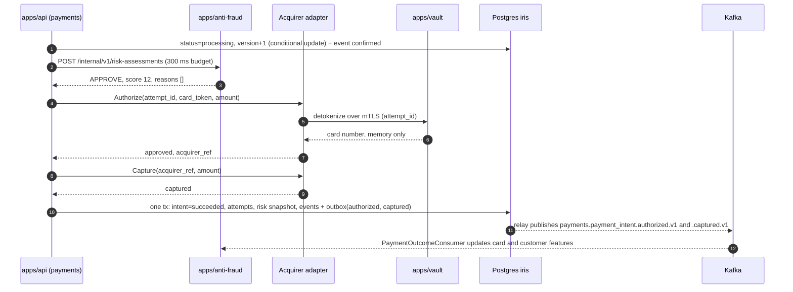

### 6.3 Review path

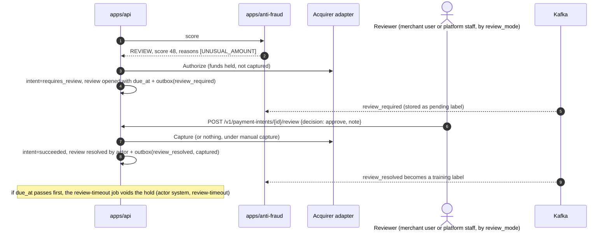

## 7. Kafka responsibilities

Kafka moves **facts that already happened**. It never carries a request that someone waits on.

| Concern | Today | Target |
| --- | --- | --- |
| Fraud decision for a payment | Planned over Kafka (`fraud.assessment.requested`), never wired | **Synchronous HTTP** inside confirm. Kafka is out of the decision path. |
| Fraud history and features | Written only by the assessment request | Kafka consumer builds per-card and per-customer features from real payment outcomes |
| Fraud labels (was the decision right?) | None | `review_resolved`, `failed`, `refunded` and, later, chargebacks feed the fraud engine as labels |
| Audit and analytics of decisions | `fraud.assessment.completed.v1` published, no consumer | Same topic, consumed by the audit log |
| Webhooks | Not built | Consume payment and checkout events and deliver them, signed, to merchant endpoints |
| Ledger | Not built | Consumes `payments.payment_intent.*` (later) |

### 7.1 Topics

| Topic | Producer | Consumers | Key |
| --- | --- | --- | --- |
| `payments.payment_intent.created.v1` | payments | analytics | payment_intent_id |
| `payments.payment_intent.authorized.v1` | payments | anti-fraud (features), webhooks | payment_intent_id |
| `payments.payment_intent.review_required.v1` | payments | anti-fraud (pending label), webhooks | payment_intent_id |
| `payments.payment_intent.review_resolved.v1` | payments | anti-fraud (label), webhooks | payment_intent_id |
| `payments.payment_intent.captured.v1` | payments | anti-fraud, webhooks, ledger later | payment_intent_id |
| `payments.payment_intent.failed.v1` | payments | anti-fraud, webhooks | payment_intent_id |
| `payments.payment_intent.canceled.v1` | payments | anti-fraud, webhooks | payment_intent_id |
| `payments.refund.succeeded.v1` | payments | anti-fraud (label), webhooks | payment_intent_id |
| `checkout.session.completed.v1` | checkout | webhooks | checkout_session_id |
| `checkout.session.expired.v1` | checkout | webhooks | checkout_session_id |
| `fraud.assessment.completed.v1` | anti-fraud | audit log | payment_intent_id |
| `<topic>.retry.<n>` / `<topic>.dlq` | each consumer | operators | same as source |

`fraud.assessment.requested.v1` is retired: the sync endpoint replaces it. Every event carries `merchant_id`, `actor_type`, `actor_id` and `request_id` in the payload.

### 7.2 Delivery rules

- **Producer side:** state change and outbox row in one transaction; the relay publishes and marks `published_at` (already true, ADR-0002).
- **Consumer side:** every consumer dedupes with an inbox keyed by `event-id` before any side effect.
- **Ordering:** the key is the aggregate id (`payment_intent_id`, `checkout_session_id`), so the events of one aggregate stay in order, and big merchants do not create hot partitions (today the key is `merchant_id`).
- **Retries:** transient errors go to retry topics with exponential backoff (for example 1 s, 10 s, 1 min); after the last retry, the message goes to the DLQ with a `failure-reason` header. Poison payloads go straight to the DLQ.
- **Schemas:** JSON Schema in the registry with `BACKWARD` compatibility. A breaking change is a new `.vN` topic.
- **Eventual consistency in features:** the sync scoring call also records the attempt itself in the fraud database, in the same transaction as the assessment. Velocity rules therefore see a burst of attempts immediately, even before the outcome events arrive.

## 8. Data model

All money columns are `bigint` minor units. All tenant-scoped tables carry `merchant_id`. "RLS" marks tables protected by row-level security (section 9).

### 8.1 Database `iris`, identity context

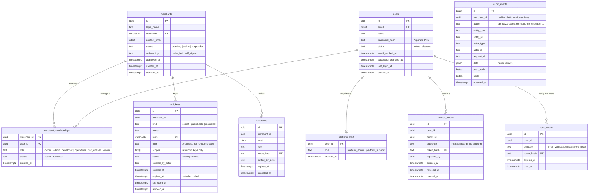

Identity tables are **not** under RLS: authentication must look keys and users up before the merchant is known. They are protected by explicit merchant scoping in every query and by the cross-tenant test suite. `audit_events` is append-only: the app role has `INSERT` and `SELECT` only.

### 8.2 Database `iris`, payments context

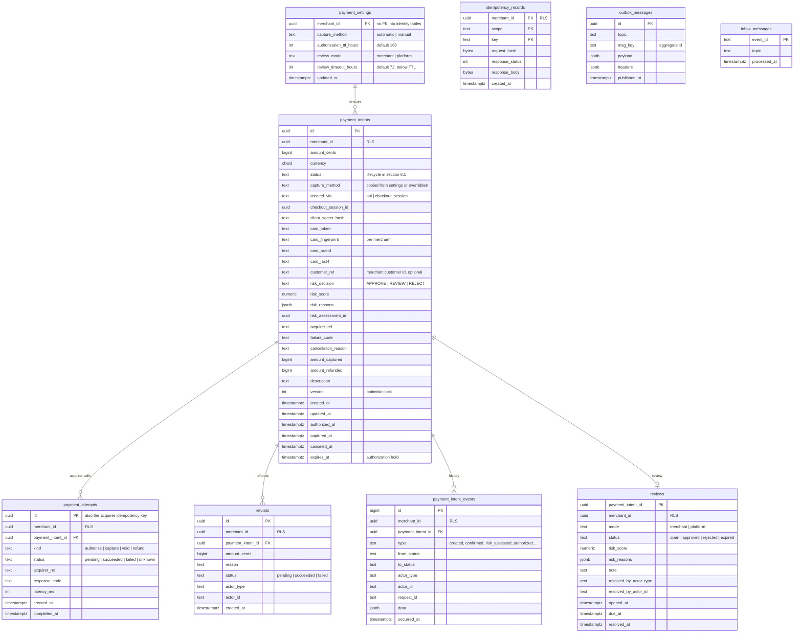

The FK from `payment_intents.merchant_id` to `merchants` is dropped: payments trusts the authenticated principal and, later, a projection fed by `identity.merchant.*` events.

### 8.3 Database `iris`, checkout context

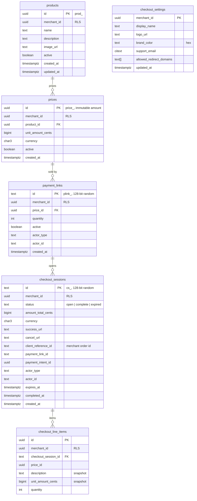

### 8.4 Database `iris`, webhooks and request log

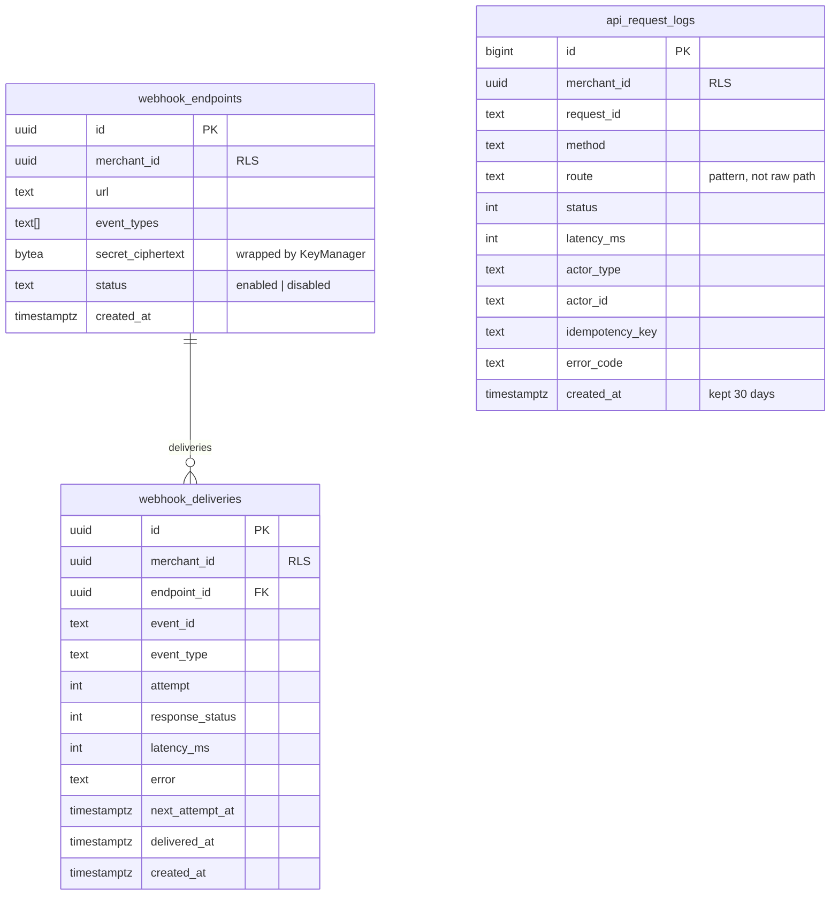

Request logs store metadata only, never request or response bodies.

### 8.5 Database `vault`

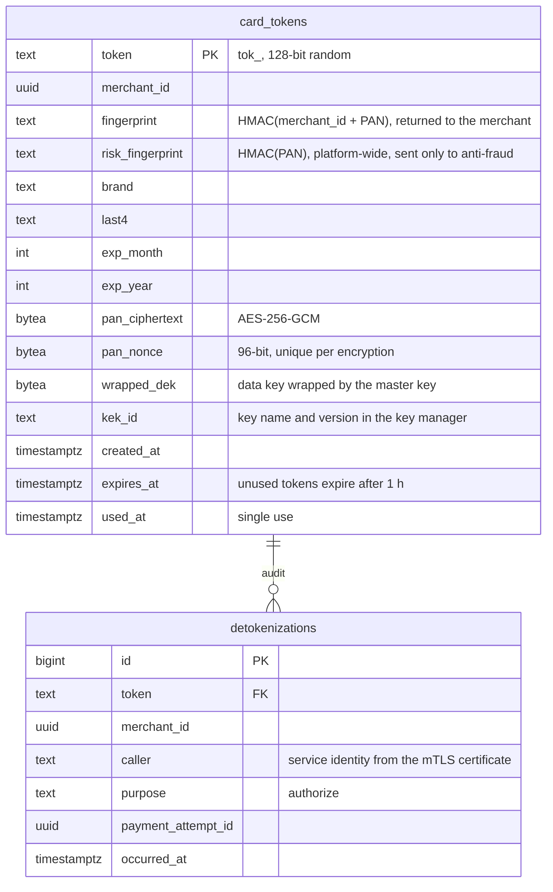

There is no CVV column anywhere.

### 8.6 Database `antifraud`

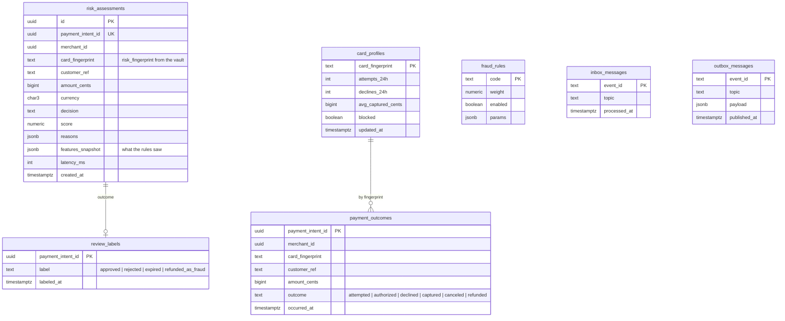

`Account.isSuspicious` becomes `card_profiles.blocked` plus a blocklist rule. Amounts move to `bigint` (fixes D6). Anti-fraud is an internal service that scores every merchant, so it has no RLS; its isolation is its own database and role.

## 9. Tenant isolation and database roles

### 9.1 Layers

1. **Principal is the only source of `merchant_id`.** Request bodies and paths never set it.
2. **Repository signatures require it**, for example `GetByID(ctx, merchantID, id)`. Forgetting the filter becomes a compile error. D1 is exactly that mistake.
3. **Row-level security.** Each request runs in a transaction that starts with `SELECT set_config('app.merchant_id', $1, true)`. Policies on RLS tables use `merchant_id = current_setting('app.merchant_id', true)::uuid`. When the setting is missing the comparison is null and no row matches. Tables use `FORCE ROW LEVEL SECURITY`.
4. **404 for other merchants' resources**, so a response never confirms that an id exists.
5. **Cross-tenant test suite.** For every route that reads or changes a merchant resource, a test creates the resource as merchant A and calls the route as merchant B (secret key, restricted key, and user JWT). Expected: 404, and no side effect. It runs in CI.

### 9.2 Roles

| Database | Role | Rights | Used by |
| --- | --- | --- | --- |
| `iris` | `iris_migrator` | owns the schema, DDL | `make migrate` only |
| `iris` | `iris_app` | DML on its tables, subject to RLS, `INSERT`/`SELECT` only on append-only tables | apps/api request handlers |
| `iris` | `iris_worker` | `BYPASSRLS`, DML on the tables jobs need | outbox relay, auth expiry, review timeout, reconciliation, webhook dispatcher |
| `iris` | `iris_platform` | `BYPASSRLS`, `SELECT` on merchant tables, writes on identity | `/v1/platform/*` handlers, separate pool |
| `antifraud` | `antifraud_migrator`, `antifraud_app` | as above | apps/anti-fraud |
| `vault` | `vault_migrator`, `vault_app` | as above | apps/vault |

Roles are created by the Postgres init scripts; passwords come from `.env`. `pg_hba` and grants make sure each app role can connect only to its own database. In a cloud deployment, the same split would use a secrets manager and IAM database authentication.

## 10. Vault cryptography

### 10.1 Tokenization and detokenization

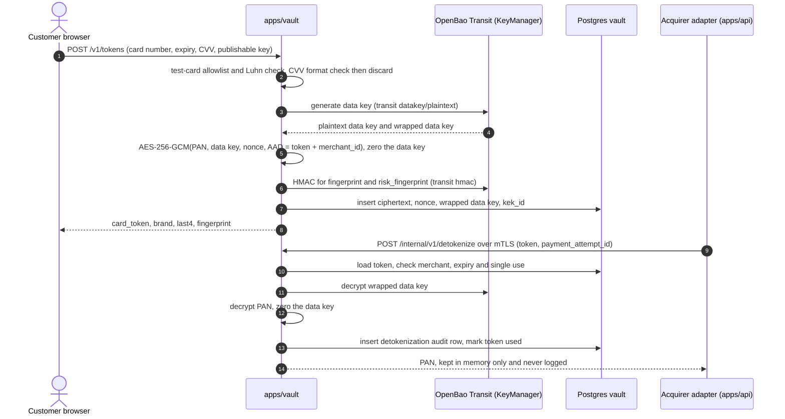

### 10.2 Rules

- The master key (KEK) lives only in the key manager. It is never in memory of any Iris Gate process, in `.env`, or in a database. Stealing the vault database yields only ciphertext and wrapped keys.
- One data key per token. The nonce is random and never reused with the same key.
- AAD binds each ciphertext to its token and merchant: moving a ciphertext to another row makes decryption fail.
- Key rotation: a new KEK version wraps new data keys; a rewrap job rewraps old data keys with `transit/rewrap` without decrypting any PAN.
- Fingerprints use keyed HMAC in the key manager, with keys separate from the encryption key. `fingerprint` includes the merchant id, so merchants cannot correlate customers across each other; `risk_fingerprint` is platform-wide and goes only to anti-fraud.
- PAN handling in Go uses `[]byte`, zeroed after use; it never becomes a `string`, a log field, an error message or a span attribute.
- The public tokenization endpoint accepts only publishable keys, has CORS limited to the checkout origin, and is rate limited per key and per IP. Anything that is not a documented test number is rejected before encryption.
- The detokenize endpoint listens on an internal port that is not published to the host, requires mTLS with a certificate issued by the local dev CA (`make certs`), and accepts only the `apps/api` service identity.
- `KeyManager` is a port with `GenerateDataKey`, `Decrypt`, `HMAC` and `Rewrap`. The OpenBao Transit adapter is the local default. An AWS KMS adapter (`GenerateDataKey`, `Decrypt`, `GenerateMac`) can be added later without touching the domain.

## 11. Classes

### 11.1 Payments (Go)

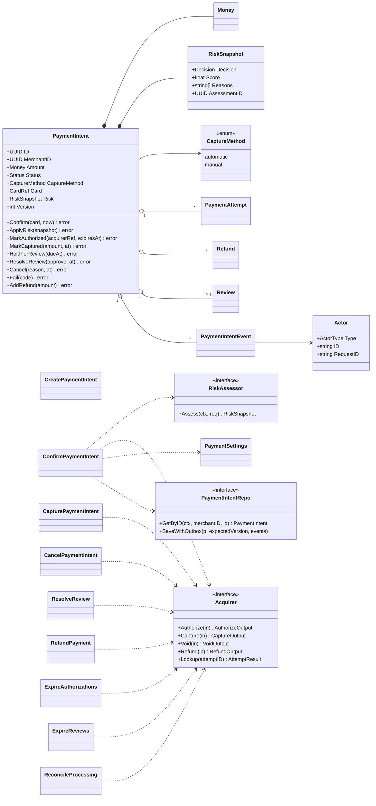

Every use case takes an `Actor` in its input and saves the intent with `expectedVersion`. A version conflict returns 409, so two concurrent confirms cannot both reach the acquirer (fixes D4). `Actor` lives in `libs/shared`.

### 11.2 Identity (Go)

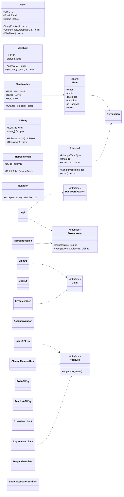

### 11.3 Fraud (TypeScript)

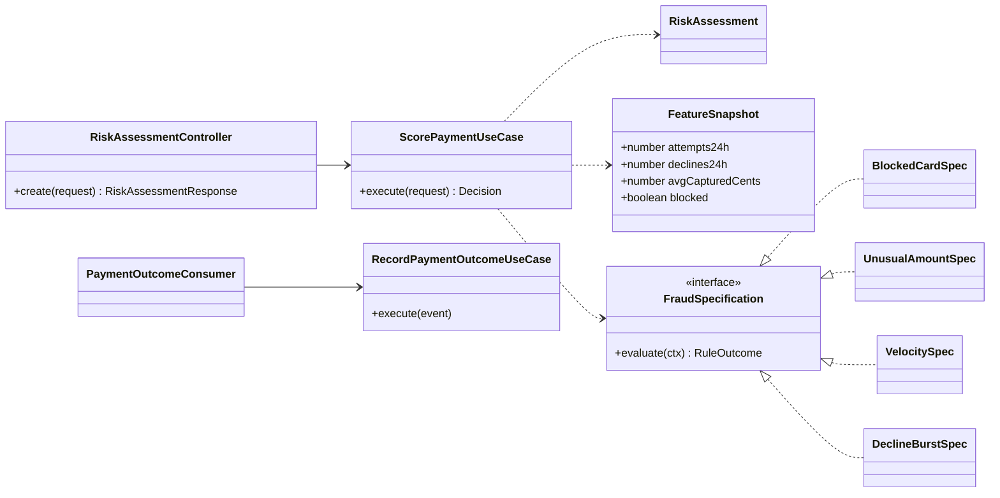

The specification pattern, weights and thresholds from `libs/fraud` stay. Rules read a `FeatureSnapshot` instead of querying history one by one, which keeps scoring within the latency budget.

## 12. API surface (v1)

"Key" means a secret or restricted API key with the listed permission; "user" means a user JWT with the listed permission. Both are accepted where both are listed.

### 12.1 Identity

| Method | Path | Caller | Notes |
| --- | --- | --- | --- |
| `POST` | `/v1/auth/signup` | public | creates user, pending merchant, owner membership; rate limited |
| `POST` | `/v1/auth/login` | public | returns access and refresh tokens; rate limited |
| `POST` | `/v1/auth/refresh` | refresh token | rotation with reuse detection |
| `POST` | `/v1/auth/logout` | user | revokes the refresh family |
| `POST` | `/v1/auth/verify-email`, `/v1/auth/password-reset`, `/v1/auth/password-reset/confirm` | public | single-use tokens |
| `POST` | `/v1/auth/reauthenticate` | user | step-up for sensitive actions |
| `POST` | `/v1/auth/switch-merchant` | user | new access token for another membership |
| `GET` | `/v1/me` | user or key | principal, merchant, permissions |
| `GET`, `POST` | `/v1/members`, `/v1/invitations` | user `members.manage` | list, invite |
| `PATCH`, `DELETE` | `/v1/members/{user_id}` | user `members.manage` | role change needs step-up |
| `POST` | `/v1/invitations/{token}/accept` | public (token) | |
| `GET`, `POST` | `/v1/api-keys` | user `api_keys.manage` | create needs step-up; secret shown once |
| `POST` | `/v1/api-keys/{id}/roll`, `/v1/api-keys/{id}/revoke` | user `api_keys.manage` | |
| `GET` | `/v1/audit-events` | user `logs.read` | |
| `GET` | `/.well-known/jwks.json` | public | |

### 12.2 Platform

| Method | Path | Caller | Notes |
| --- | --- | --- | --- |
| `GET`, `POST` | `/v1/platform/merchants` | `platform_admin` | create sends the owner invitation |
| `POST` | `/v1/platform/merchants/{id}/approve`, `/suspend`, `/reactivate` | `platform_admin` | audited |
| `GET` | `/v1/platform/reviews` | `platform_admin` | queue for `review_mode = platform` |
| `POST` | `/v1/platform/reviews/{payment_intent_id}` | `platform_admin` | approve or reject |
| `GET` | `/v1/platform/metrics` | `platform_admin` | volume, approval rate, fraud rate, open reviews per merchant |

### 12.3 Payments

| Method | Path | Caller | Notes |
| --- | --- | --- | --- |
| `POST` | `/v1/payment-intents` | key or user `payments.write` | `Idempotency-Key` required; returns `client_secret` |
| `POST` | `/v1/payment-intents/{id}/confirm` | key `payments.write` | scores, authorizes and, if automatic, captures |
| `POST` | `/v1/payment-intents/{id}/capture` | key or user `payments.capture` | only from `requires_capture` |
| `POST` | `/v1/payment-intents/{id}/cancel` | key or user `payments.cancel` | voids the hold if there is one |
| `POST` | `/v1/payment-intents/{id}/review` | user `reviews.resolve` | `{decision, note}`; only when `review_mode = merchant` |
| `POST` | `/v1/payment-intents/{id}/refunds` | key or user `refunds.create` | partial or full; `Idempotency-Key` required |
| `GET` | `/v1/payment-intents`, `/v1/payment-intents/{id}`, `/v1/payment-intents/{id}/events` | key or user `payments.read` | filters by status, including `requires_review` |
| `GET`, `PUT` | `/v1/payment-settings` | user `settings.write` (GET: `payments.read`) | capture method, TTL, review mode, review timeout |

`/authorize` is removed: authorization is a step of confirm, not an endpoint. Idempotency records are keyed by merchant (fixes D2).

### 12.4 Checkout and catalog

| Method | Path | Caller | Notes |
| --- | --- | --- | --- |
| `GET`, `POST`, `PATCH` | `/v1/products`, `/v1/products/{id}` | key or user `catalog.write` (GET: `payments.read`) | archive with `active = false` |
| `GET`, `POST` | `/v1/prices` | same | immutable; archive with `PATCH {active: false}` |
| `POST` | `/v1/checkout/sessions` | key or user `checkout.write` | `Idempotency-Key` required |
| `GET` | `/v1/checkout/sessions/{id}` | key or user `payments.read` | for merchant verification |
| `POST` | `/v1/checkout/sessions/{id}/expire` | key or user `checkout.write` | |
| `GET` | `/v1/checkout/sessions/{id}/public` | public (session id) | display data only |
| `POST` | `/v1/checkout/sessions/{id}/confirm` | public (session id) + card_token | rate limited |
| `GET`, `POST`, `PATCH` | `/v1/payment-links` | key or user `checkout.write` | |
| `POST` | `/v1/payment-links/{id}/sessions` | public (link id) | creates a session and returns its URL |
| `GET`, `PUT` | `/v1/checkout-settings` | user `settings.write` | branding, allowed redirect domains |

### 12.5 Webhooks and logs

| Method | Path | Caller | Notes |
| --- | --- | --- | --- |
| `GET`, `POST`, `PATCH`, `DELETE` | `/v1/webhook-endpoints` | user `webhooks.manage` | secret shown once |
| `GET` | `/v1/webhook-endpoints/{id}/deliveries` | user `webhooks.manage` | |
| `POST` | `/v1/webhook-deliveries/{id}/redeliver` | user `webhooks.manage` | |
| `GET` | `/v1/request-logs` | user `logs.read` | last 30 days |

Webhook signature header: `Iris-Signature: t=<unix seconds>,v1=<hex HMAC-SHA256(secret, "<t>.<raw body>")>`. Receivers reject timestamps older than 5 minutes.

## 13. Test cards and test tokens

| Card number (test only) | Magic token (no vault) | Outcome |
| --- | --- | --- |
| `4242 4242 4242 4242` | `tok_test_approved` | approved |
| `4000 0000 0000 0002` | `tok_test_declined` | declined (`card_declined`) |
| `4000 0000 0000 9995` | `tok_test_insufficient_funds` | declined (`insufficient_funds`) |
| `4000 0000 0000 0259` | `tok_test_blocked` | blocked card, risk `REJECT` |
| `4000 0000 0000 9235` | `tok_test_review` | elevated risk, `REVIEW` |
| `4000 0000 0000 0119` | `tok_test_timeout` | acquirer timeout, leaves an attempt `unknown` for reconciliation |

Magic tokens let the payment lifecycle be built and tested before the vault exists; they keep working afterwards for API-only tests, as Stripe's `tok_visa` does. The fake acquirer and the anti-fraud test hooks key off the card number when it comes from the vault, and off the magic token otherwise.

## 14. Delivery

The phases, their order and their guidelines are in [`../specs/README.md`](../specs/README.md). They replace the work packages of the first draft of this document and the pending phases 6 to 10 of [`../roadmap.md`](../roadmap.md).

## 15. Resolved items

| ID | Question | Resolution |
| --- | --- | --- |
| O1 | The lifecycle changes the v1 contract. `AGENTS.md` says breaking changes go to `/v2`. | Change v1 in place: there are no external clients. Record it in an ADR. |
| O2 | Vault as a separate app or a Go context inside apps/api? | Separate app (`apps/vault`), with its own database and role (decision 22). |
| O3 | Partial capture? | Not in this iteration. |
| O4 | Merchant projection fed by `identity.merchant.*` events now, or later? | Later. The FK is dropped now; payments trusts the principal. |
| O5 | 3-D Secure as a fourth risk outcome? | Not in this iteration. |
| O6 | Where does the demo run? | Locally with Docker Compose through the end-to-end phase; AWS with Terraform is a later phase. |
