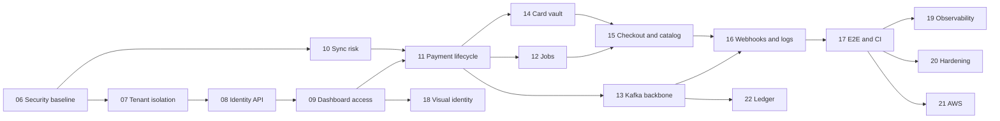

# Roadmap

Iris Gate is a portfolio project: it will never run in production, process real money, or be sold (see [`design/to-be.md`](design/to-be.md) section 1). This roadmap shows what is built, what comes next, and where each piece is specified.

| Document | Role |
| --- | --- |
| [`design/as-is.md`](design/as-is.md) | Snapshot of the code at commit `7195707`, with known defects (D1 to D9) and gaps (G1 to G10) |
| [`design/to-be.md`](design/to-be.md) | Approved target design (2026-11-10): decisions, diagrams, data model, API surface |
| [`specs/`](specs/README.md) | One spec per delivery phase, plus the working rules for the implementing agent |
| `plans/` | Implementation plans, written by the agent before each phase |

## Overview

| Phase | Name | Status | Spec |
| --- | --- | --- | --- |
| 0 | Foundation | done | below |
| 1 | Contracts first | done | below |
| 2 | Identity (merchants and API keys) | done | below |
| 3 | Payments (intents, outbox, idempotency) | done | below |
| 4 | Anti-fraud (async scoring, inbox, DLQ) | done | below |
| 5 | Web dashboard MVP | done | below |
| 6 | Security baseline | ready | [phase-06](specs/phase-06-security-baseline.md) |
| 7 | Database roles and tenant isolation | ready | [phase-07](specs/phase-07-tenant-isolation.md) |
| 8 | Identity and access API | ready | [phase-08](specs/phase-08-identity-access-api.md) |
| 9 | Dashboard and console access | ready | [phase-09](specs/phase-09-dashboard-console-access.md) |
| 10 | Synchronous risk scoring | ready | [phase-10](specs/phase-10-sync-risk-scoring.md) |
| 11 | Payment lifecycle and review | ready | [phase-11](specs/phase-11-payment-lifecycle.md) |
| 12 | Background jobs | ready | [phase-12](specs/phase-12-background-jobs.md) |
| 13 | Kafka event backbone | ready | [phase-13](specs/phase-13-kafka-backbone.md) |
| 14 | Card vault | ready | [phase-14](specs/phase-14-card-vault.md) |
| 15 | Hosted checkout, catalog and payment links | ready | [phase-15](specs/phase-15-checkout-catalog.md) |
| 16 | Webhooks and request logs | ready | [phase-16](specs/phase-16-webhooks-request-logs.md) |
| 17 | End-to-end tests and CI | ready | [phase-17](specs/phase-17-e2e-ci.md) |
| 18 | Visual identity refresh | blocked: owner design session | [phase-18](specs/phase-18-visual-identity.md) |
| 19 | Observability | later | to be written |
| 20 | Security hardening | later | to be written |
| 21 | Cloud deployment (AWS, Terraform) | later | to be written |
| 22 | Ledger | later | to be written |

The live status of phases 6 to 18 is kept in [`specs/README.md`](specs/README.md); update both tables when a phase changes status.

Phase 10 can run in parallel with 7 to 9. Phases 12, 13 and 14 can run in parallel after 11.

---

## Done: phases 0 to 5

These phases built the skeleton and the first vertical slice. The as-is document describes the result, including the defects that phase 6 fixes. Notes below keep the decisions that differ from the first plan.

### Phase 0: Foundation

**Goal:** a runnable monorepo.

- Root `package.json` with Yarn 4 workspaces (`apps/*`, `libs/*`), `go.work`, editor and formatter config.
- Docker Compose with Postgres 18.3 and Apache Kafka (KRaft, single node).
- Root Makefile (`bootstrap`, `up`, `down`, `nuke`, fan-out `dev`, `test`, `lint`, `build`, `clean`) and `infra/docker/Makefile`.
- Lefthook: gofumpt, go vet, Prettier, gitleaks on pre-commit; Conventional Commits on commit-msg.
- GitHub Actions CI with per-app path filters.
- Skeletons for `apps/api` (Go, chi, slog, health checks, distroless image), `apps/web` (Next 16, React 19) and `apps/anti-fraud` (Nest 11).

Decisions: Yarn 4 instead of pnpm, Makefiles instead of a bootstrap script, Kafka instead of Redpanda, Postgres 18 instead of 16, Turborepo deferred.

### Phase 1: Contracts first

**Goal:** one source of truth for HTTP and event contracts.

- OpenAPI 3.1 specs in `libs/contracts/http/`, AsyncAPI and JSON Schema 2020-12 in `libs/contracts/events/`.
- Codegen: oapi-codegen (Go, registered as a `go.mod` tool) and openapi-typescript (types only).
- Karapace schema registry with `BACKWARD` compatibility.
- [ADR-0003](adr/0003-contracts-as-source-of-truth.md); `make gen-contracts` and the `gen-contracts-check` CI gate.

Done when renaming a field in a spec broke both the Go build and the TypeScript typecheck.

### Phase 2: Identity

**Goal:** merchants and API keys.

- `libs/identity` domain, use cases (`CreateMerchant`, `IssueAPIKey`, `AuthenticateAPIKey`, `RevokeAPIKey`), pgx v5 store with embedded migrations, Argon2id hasher.
- Token format `irk_<prefix>.<secret>`; missing or invalid key 401, revoked key 403; RFC 7807 errors.
- Go bumped to 1.25 (required by `golang.org/x/crypto`).

Decisions: hand-written pgx instead of sqlc; users and roles deferred (now phase 8). The merchant and key routes were left public for local bootstrap; this is defect D8, fixed in phase 6.

### Phase 3: Payments

**Goal:** payment intents with idempotency and transactional events.

- `Money` value object, `PaymentIntent` with `pending → authorized → captured`, use cases for create, authorize and capture.
- Postgres store with intent and outbox in one transaction; Stripe-style idempotency middleware; Kafka relay worker with W3C trace headers.
- `FakeAcquirer` (always approves) and a configurable `HTTPAcquirer`.
- Routes `POST /v1/payment-intents`, `/authorize`, `/capture`; OpenAPI and AsyncAPI updated.

Deferred then, now planned: refunds and void (phase 11), card tokenization (phase 14).

### Phase 4: Anti-fraud

**Goal:** fraud decisions with the specification pattern, inbox and outbox.

- `libs/fraud` (TypeScript): `RiskAssessment`, `Decision`, `Score`, `DecisionThresholds`, three weighted specifications.
- `apps/anti-fraud` (Nest 11, KafkaJS, Prisma 5.22): consumer with inbox dedupe, outbox relay, DLQ `fraud.assessment.failed.dlq`.
- Score model: weighted sum saturated at 100; `APPROVE < 30`, `REVIEW < 70`, `REJECT ≥ 70`.

The request topic `fraud.assessment.requested.v1` never got a producer. Phase 10 replaces it with a synchronous endpoint.

### Phase 5: Web dashboard MVP

**Goal:** a working merchant dashboard.

- Next 16 with Tailwind 4 (OKLCH tokens) and shadcn/ui; next-intl (`en`, `pt`, `es`).
- iron-session login with the merchant's API key; `libs/sdk-web` typed client.
- Pages: landing, login, overview, payment intent list, create, detail with authorize and capture buttons.
- `GET /v1/payment-intents` list and detail routes added to the API.
- Playwright smoke tests for the landing page and the auth redirect.

Logging in with the API key is defect D9, replaced by user accounts in phases 8 and 9. The manual authorize and capture buttons are replaced by the market lifecycle in phase 11.

---

## Next: phases 6 to 18

Each phase has a spec with scope, rules and acceptance criteria. Summaries:

| Phase | Outcome |
| --- | --- |
| 6. Security baseline | Tenant check on every by-id route, idempotency keyed by merchant, persisted declines, optimistic locking, public identity routes replaced by the `irisctl` CLI. |
| 7. Database roles and tenant isolation | Migrator, app, worker and platform roles per database; Postgres row-level security; tenant transaction helper; cross-tenant test suite with a route meta-test. |
| 8. Identity and access API | Users, Argon2id passwords, Ed25519 JWT with rotating refresh tokens, roles and permissions, memberships, invitations, self-signup with approval, API key kinds (secret, restricted, publishable), platform admin, hash-chained audit log, Mailpit. |
| 9. Dashboard and console access | Login, sign-up, team, API keys, audit log and profile pages; platform console at `/admin`; the API key leaves the session cookie. |
| 10. Synchronous risk scoring | Internal scoring endpoint in anti-fraud with a 300 ms budget, feature snapshot, new rules, `bigint` amounts, fail-closed client in payments. |
| 11. Payment lifecycle and review | Confirm with automatic capture by default, manual capture setting, review in merchant or platform mode, cancel, refunds, payment history with actors, dashboard and console screens. |
| 12. Background jobs | Worker process for authorization expiry, review deadline and reconciliation of stuck payments. |
| 13. Kafka event backbone | Full event set keyed by aggregate, schema compatibility check, retry topics and DLQ, anti-fraud outcome consumer for features and labels. |
| 14. Card vault | Separate `apps/vault` with envelope encryption under OpenBao Transit, keyed fingerprints, single-use tokens, mTLS detokenization with audit, key rotation. |
| 15. Hosted checkout, catalog and payment links | Products and immutable prices, server-created checkout sessions, payment links, merchant branding, hosted pay page with browser-to-vault card form, demo store. |
| 16. Webhooks and request logs | Signed webhooks with scheduled retries, SSRF protection, delivery log and redeliver; API request log with 30-day retention. |
| 17. End-to-end tests and CI | Playwright suite over the Compose stack for every flow and test card; CI with contract, schema, cross-tenant, security and log-scan checks. |
| 18. Visual identity refresh | New palette and themes with neutral backgrounds, WCAG AA contrast. Starts after the owner's design session. |

## Later

These phases have no spec yet. Write one in `specs/` before starting.

- **19. Observability.** OpenTelemetry in every service, trace context over HTTP and Kafka, Prometheus, Grafana and Jaeger, SLO alerts, dashboards as code.
- **20. Security hardening.** Strict CSP and the remaining headers of [`security.md`](security.md), rate limits per API key, automated OWASP ZAP scan, written threat model.
- **21. Cloud deployment.** AWS with Terraform: managed Postgres with IAM authentication, Secrets Manager, KMS adapter for the `KeyManager` port, managed Kafka or an equivalent, CI deploy of a demo environment.
- **22. Ledger.** Double-entry journal fed by payment events, balance and statement endpoints.

Ideas beyond that, not committed: embedded card fields, 3-D Secure, partial capture, MFA, `platform_support` role with audited read-only impersonation, ML scoring served next to the rules, official SDKs (Node, Python, Go), Pix.

The earlier plan for a private beta with pilot merchants and a public status page was dropped: the project will never run in production.

## Success metrics

| Metric | Target | Checked in |
| --- | --- | --- |
| p95 latency of `POST /v1/payment-intents` | < 300 ms | phase 19 |
| p99 latency of the risk endpoint | < 100 ms locally | phase 10 |
| Routes covered by the cross-tenant suite | 100% (meta-test) | phase 7 onward |
| Routes with a declared permission | 100% (registry test) | phase 8 onward |
| Card numbers in any service log | 0 (log-scan test) | phase 14 onward |
| Idempotent replay correctness | 100% | phases 6 and 11 |
| Test coverage of `domain/` packages | > 90% | every phase |
| End-to-end suite on every pull request | green | phase 17 onward |
| p95 consumer lag in anti-fraud | < 500 ms | phase 19 |
